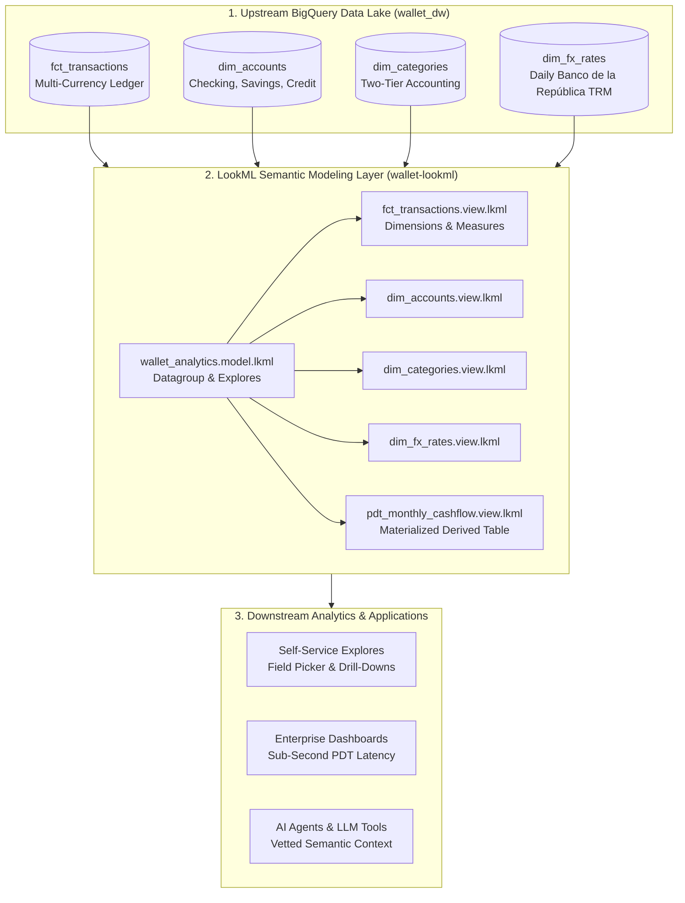

# Wallet LookML — Enterprise Semantic Modeling Layer

[](https://github.com/quiquecg/wallet-lookml/actions)
[](https://cloud.google.com/looker/docs/what-is-lookml)
[](https://cloud.google.com/bigquery)
[](https://en.wikipedia.org/wiki/Databricks#Medallion_architecture)

A production-grade, Git-versioned **LookML semantic modeling repository** for the [Wallet Personal Finance Automation Lake](https://github.com/quiquecg/wallet). This project bridges a multi-currency Medallion data lake on **Google Cloud BigQuery** with enterprise-grade metric governance, Persistent Derived Tables (PDTs), and symmetric aggregate explorations.

---

## 1. Architectural Motivation & Problem Statement

### The Anti-Pattern: Ad-Hoc Dashboard Calculations
In traditional Business Intelligence tools (e.g. basic Looker Studio or Power BI reports), metric formulas are defined individually inside charts and widgets. This leads to:
1. **Metric Drift**: Different dashboards calculate "Monthly Net Cash Flow" or "Operational Burn Rate" using inconsistent filters.
2. **SQL Fanout Errors**: Joining fact tables (`1:N`) to dimensional tables multiplies amounts unless complex deduplication logic is manually written in raw SQL.
3. **Dashboard Latency**: Heavy multi-table aggregations scan gigabytes of data on every refresh.

### The Solution: LookML Centralized Semantic Layer
LookML decouples **SQL business logic** from **visual presentation**. By centralizing dimensions, measures, and join relationships in Git:
* Every downstream dashboard, user query, or automated assistant consumes the **exact same vetted business logic**.
* Looker's query generator automatically generates **Symmetric Aggregates** (using primary keys and `relationship: many_to_one`) to prevent fanout bugs mathematically.
* Caching and materialization policies are governed via declarative **Datagroups** and **Persistent Derived Tables (PDTs)**.

---

## 2. System Architecture & Information Flow



---

## 3. Key LookML Design Patterns Implemented

### A. Symmetric Aggregates & Fanout Protection
In `models/wallet_analytics.model.lkml`, dimensional relationships are declared with explicit cardinality:

```lookml
explore: fct_transactions {
  label: "Personal Finance & Cash Flow Ledger"

  join: dim_accounts {
    relationship: many_to_one
    sql_on: ${fct_transactions.account_id} = ${dim_accounts.account_id} ;;
  }

  join: dim_categories {
    relationship: many_to_one
    sql_on: ${fct_transactions.category_id} = ${dim_categories.category_id} ;;
  }
}
```
Because `transaction_id` and `account_id` are flagged with `primary_key: yes`, Looker calculates accurate sums regardless of join fanouts.

### B. Two-Tier Accounting Metric Governance
The model encodes the [[two-tier-accounting|Two-Tier Accounting]] methodology into standardized measures:
* **Tier 1 (Living Expenses)**: Routine operational burn rate (housing, sustenance, utilities).
* **Tier 2 (Capital Allocation)**: Sinking funds, investments, and long-term liquidity reserves.

```lookml
measure: tier1_operational_spend_usd {
  type: sum
  sql: ABS(${amount_usd}) ;;
  filters: [is_transfer: "no", amount_usd: "<0", dim_categories.accounting_tier: "1"]
  value_format_name: usd
}

measure: savings_rate_percentage {
  type: number
  sql: SAFE_DIVIDE(${net_cash_flow_usd}, ${total_income_usd}) ;;
  value_format_name: percent_2
}
```

### C. Persistent Derived Tables (PDTs) & Datagroup Caching
To optimize BigQuery query costs and deliver sub-second dashboard performance, `views/derived/pdt_monthly_cashflow.view.lkml` materializes monthly rollups:

```lookml
datagroup: wallet_daily_datagroup {
  sql_trigger: SELECT MAX(transaction_date) FROM `wallet_dw.fct_transactions` ;;
  max_cache_age: "24 hours"
}

view: pdt_monthly_cashflow {
  derived_table: {
    sql:
      SELECT
        DATE_TRUNC(t.transaction_date, MONTH) AS month_date,
        SUM(CASE WHEN t.is_transfer = FALSE AND t.amount_usd > 0 THEN t.amount_usd ELSE 0 END) AS monthly_income_usd,
        SUM(CASE WHEN t.is_transfer = FALSE AND t.amount_usd < 0 THEN ABS(t.amount_usd) ELSE 0 END) AS monthly_spend_usd
      FROM `wallet_dw.fct_transactions` t
      GROUP BY 1 ;;
    datagroup_trigger: wallet_daily_datagroup
    indexes: ["month_date"]
  }
}
```

---

## 4. Repository Structure

```text
wallet-lookml/
├── .github/
│   └── workflows/
│       └── lookml_lint.yml          # Automated CI/CD syntax and linting pipeline
├── manifest.lkml                    # Project manifest, global constants, and schema names
├── models/
│   └── wallet_analytics.model.lkml  # BigQuery connection, datagroups, explores, and joins
├── views/
│   ├── base/                        # Physical table bindings
│   │   ├── dim_accounts.view.lkml
│   │   ├── dim_categories.view.lkml
│   │   ├── dim_fx_rates.view.lkml
│   │   └── fct_transactions.view.lkml
│   └── derived/                     # Persistent Derived Tables (PDTs)
│       └── pdt_monthly_cashflow.view.lkml
├── tests/
│   └── data_tests.lkml              # Native LookML test blocks (asserting uniqueness & valid spend)
├── scripts/
│   └── validate_lookml.py           # Python lkml parser validating syntax and primary keys
├── requirements.txt                 # Dependencies (`lkml`)
└── README.md
```

---

## 5. Local Validation & CI/CD Testing

The project uses the open-source Python parser [`lkml`](https://github.com/joshtemple/lkml) to lint and validate all files locally:

```bash
# 1. Install validation dependencies
pip install -r requirements.txt

# 2. Run the automated LookML validator
python scripts/validate_lookml.py
```

Output:
```text
Validating 8 LookML file(s) across project...
  [PASS] manifest.lkml
  [PASS] models/wallet_analytics.model.lkml
  [PASS] tests/data_tests.lkml
  [PASS] views/base/dim_accounts.view.lkml
  [PASS] views/base/dim_categories.view.lkml
  [PASS] views/base/dim_fx_rates.view.lkml
  [PASS] views/base/fct_transactions.view.lkml
  [PASS] views/derived/pdt_monthly_cashflow.view.lkml
------------------------------------------------------------
All 8 LookML files parsed and validated successfully!
```

---

## 6. Technical Interview Demonstration Guide

When presenting this project during a Senior Data/AI Engineer technical screening:

1. **Walk Through the Architecture**: Explain how raw bank alerts (IMAP) and BudgetBakers API data land in BigQuery as a Medallion Lakehouse, and why LookML was chosen to govern the semantic layer.
2. **Demonstrate Symmetric Aggregates**: Open `models/wallet_analytics.model.lkml` and explain how `relationship: many_to_one` prevents fanout multiplication when querying multi-currency transactions across accounts.
3. **Explain Caching & Performance**: Highlight `wallet_daily_datagroup` and the Persistent Derived Table (`pdt_monthly_cashflow`), explaining how caching offloads heavy computation from BigQuery.
4. **Highlight CI/CD Rigor**: Show the automated GitHub Actions workflow and `scripts/validate_lookml.py` running automated syntax and primary-key checks on every git push.
