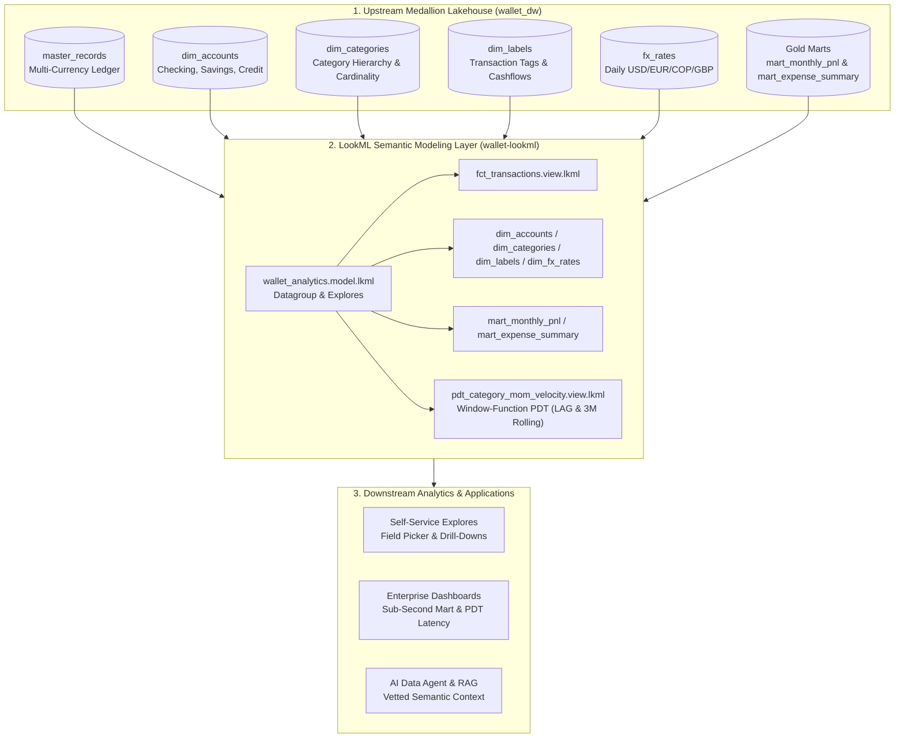

# Wallet LookML — Enterprise Semantic Modeling Layer

[](https://github.com/carlosgilroa/wallet-lookml/actions)
[](https://cloud.google.com/looker/docs/what-is-lookml)
[](https://cloud.google.com/bigquery)
[](https://en.wikipedia.org/wiki/Databricks#Medallion_architecture)

A production-grade, Git-versioned **LookML semantic modeling repository** for the [Wallet Personal Finance Automation Lake](https://github.com/carlosgilroa/wallet). This project bridges a multi-currency Medallion data lakehouse (`silver/` and `gold/` Parquet tables) with enterprise-grade metric governance, Persistent Derived Tables (PDTs), and symmetric aggregate explorations.

---

## 1. Architectural Motivation & Problem Statement

### The Anti-Pattern: Ad-Hoc Dashboard Calculations
In traditional Business Intelligence tools (e.g. basic Looker Studio or Power BI reports), metric formulas are defined individually inside charts and widgets. This leads to:
1. **Metric Drift**: Different dashboards calculate "Monthly Net Cash Flow" or "Operational Burn Rate" using inconsistent filters.
2. **SQL Fanout Errors**: Joining fact tables (`1:N`) to dimensional tables multiplies amounts unless complex deduplication logic is manually written in raw SQL.
3. **Dashboard Latency**: Heavy multi-table aggregations scan gigabytes of data on every refresh.

### The Solution: LookML Centralized Semantic Layer
LookML decouples **SQL business logic** from **visual presentation**. By centralizing dimensions, measures, and join relationships in Git:
* Every downstream dashboard, user query, or automated assistant consumes the **exact same vetted business logic**.
* Looker's query generator automatically generates **Symmetric Aggregates** (using primary keys and `relationship: many_to_one`) to prevent fanout bugs mathematically.
* Caching and materialization policies are governed via declarative **Datagroups** and **Persistent Derived Tables (PDTs)**.

---

## 2. System Architecture & Information Flow



---

## 3. Key LookML Design Patterns Implemented

### A. Symmetric Aggregates & Fanout Protection
In `models/wallet_analytics.model.lkml`, dimensional relationships are declared with explicit cardinality across the `transactions`, `monthly_pnl`, and `category_velocity` explores:

```lookml
explore: transactions {
  from: fct_transactions
  view_name: fct_transactions
  label: "Personal Finance & Cash Flow Ledger"

  join: dim_accounts {
    type: left_outer
    relationship: many_to_one
    sql_on: ${fct_transactions.account_id} = ${dim_accounts.account_id} ;;
  }

  join: dim_categories {
    type: left_outer
    relationship: many_to_one
    sql_on: ${fct_transactions.category_id} = ${dim_categories.category_id} ;;
  }
}
```
Because `transaction_id`, `account_id`, `category_id`, and `label_id` are flagged with `primary_key: yes`, Looker calculates accurate sums regardless of join fanouts.

### B. Two-Tier Accounting Metric Governance
The model encodes the Two-Tier Accounting methodology into standardized measures:
* **Tier 1 (Living Expenses)**: Routine operational burn rate (`nature: "tier1_operational_cost"`).
* **Tier 2 (Capital Allocation)**: Sinking funds, investments, and long-term liquidity reserves (`nature: "tier2_capital_outlay"`).

```lookml
measure: tier1_operational_spend_usd {
  type: sum
  sql: ABS(${TABLE}.amount) ;;
  filters: [is_transfer: "no", type: "expense", nature: "tier1_operational_cost"]
  value_format_name: usd
}

measure: savings_rate_percentage {
  type: number
  sql: (${total_income_usd} - ${total_spend_usd}) / NULLIF(${total_income_usd}, 0) * 100 ;;
  value_format_name: decimal_2
}
```

### C. Gold Marts & Window-Function Persistent Derived Tables (PDTs)
Pre-aggregated Gold tables (`mart_monthly_pnl.view.lkml` and `mart_expense_summary.view.lkml`) are mapped directly with dynamic multi-period ratio measures (`dynamic_period_savings_rate_pct`), while `views/derived/pdt_category_mom_velocity.view.lkml` uses SQL window functions (`LAG()` and 3-month rolling `AVG() OVER (...)`) to compute month-over-month spend acceleration:

```lookml
datagroup: wallet_daily_datagroup {
  sql_trigger: SELECT MAX(date) FROM `@{schema_name}.master_records` ;;
  max_cache_age: "24 hours"
}

view: pdt_category_mom_velocity {
  derived_table: {
    sql:
      WITH monthly_cat AS (
        SELECT
          STRFTIME(CAST(t.date AS DATE), '%Y-%m') AS year_month,
          t.category_id,
          COALESCE(c.category_name, t.category_name) AS category_name,
          COALESCE(c.category_group, t.category_group) AS category_group,
          SUM(ABS(t.amount)) AS monthly_spend_cop
        FROM `@{schema_name}.master_records` t
        LEFT JOIN `@{schema_name}.dim_categories` c
          ON t.category_id = c.category_id
        WHERE t.is_transfer = FALSE AND t.type = 'expense'
        GROUP BY 1, 2, 3, 4
      )
      SELECT
        *,
        LAG(monthly_spend_cop) OVER (PARTITION BY category_id ORDER BY year_month) AS prev_month_spend_cop,
        AVG(monthly_spend_cop) OVER (
          PARTITION BY category_id ORDER BY year_month ROWS BETWEEN 2 PRECEDING AND CURRENT ROW
        ) AS rolling_3m_avg_spend_cop
      FROM monthly_cat ;;
    datagroup_trigger: wallet_daily_datagroup
  }
}
```

---

## 4. Repository Structure

```text
wallet-lookml/
├── .github/
│   └── workflows/
│       └── lookml_lint.yml                     # Automated CI/CD syntax and linting pipeline
├── manifest.lkml                               # Project manifest, global constants, and schema names
├── models/
│   └── wallet_analytics.model.lkml             # Connection, datagroups, explores, and joins
├── views/
│   ├── base/                                   # Silver layer physical table bindings
│   │   ├── dim_accounts.view.lkml              # Conformed accounts dimension (25 attributes)
│   │   ├── dim_categories.view.lkml            # Conformed categories dimension & hierarchy
│   │   ├── dim_labels.view.lkml                # Conformed labels/tags dimension
│   │   ├── dim_fx_rates.view.lkml              # Daily multi-currency FX rates
│   │   └── fct_transactions.view.lkml          # Master transaction ledger (master_records)
│   └── derived/                                # Gold Marts & Persistent Derived Tables (PDTs)
│       ├── mart_monthly_pnl.view.lkml          # Monthly P&L Gold mart + dynamic ratios
│       ├── mart_expense_summary.view.lkml      # Monthly category expense & budget variance mart
│       └── pdt_category_mom_velocity.view.lkml # Window-function MoM category spend velocity PDT
├── tests/
│   └── data_tests.lkml                         # Native LookML test blocks
├── scripts/
│   └── validate_lookml.py                      # LookML AST parser + DuckDB EXPLAIN validator for PDTs
├── requirements.txt                            # Dependencies (`lkml`, `duckdb`)
└── README.md
```

---

## 5. Local Validation & CI/CD Testing

The project uses the open-source Python parser [`lkml`](https://github.com/joshtemple/lkml) plus **DuckDB `EXPLAIN` verification** to validate all LookML views, primary keys, and derived table SQL against the physical Parquet schemas:

```bash
# 1. Install validation dependencies
pip install -r requirements.txt

# 2. Run the automated LookML & DuckDB EXPLAIN validator
python scripts/validate_lookml.py
```

Output:
```text
Validating 11 LookML file(s) across project...
  [PASS] manifest.lkml
  [PASS] models\wallet_analytics.model.lkml
  [PASS] tests\data_tests.lkml
  [PASS] views\base\dim_accounts.view.lkml
  [PASS] views\base\dim_categories.view.lkml
  [PASS] views\base\dim_fx_rates.view.lkml
  [PASS] views\base\dim_labels.view.lkml
  [PASS] views\base\fct_transactions.view.lkml
  [PASS] views\derived\mart_expense_summary.view.lkml
  [PASS] views\derived\mart_monthly_pnl.view.lkml
  [INFO] DuckDB EXPLAIN verified for derived_table in view 'pdt_category_mom_velocity'
  [PASS] views\derived\pdt_category_mom_velocity.view.lkml
------------------------------------------------------------
All 11 LookML files parsed and validated successfully!
```

---

## 6. Architecture & Data Governance Walkthrough

This semantic layer adheres to enterprise data engineering and analytics engineering standards:

1. **Decoupled Medallion Architecture**: The semantic model operates directly over Silver (`master_records`, `dim_accounts`, `dim_categories`, `dim_labels`, `fx_rates`) and Gold (`mart_monthly_pnl`, `mart_expense_summary`) layers, providing centralized governance across multi-currency financial records.
2. **Symmetric Aggregates & Join Safety**: By enforcing primary keys (`transaction_id`, `account_id`, `category_id`, `label_id`) and declaring explicit join relationships (`relationship: many_to_one`), the model guarantees mathematically accurate metrics regardless of query dimensionality or join depth.
3. **Window-Function PDTs**: `pdt_category_mom_velocity` computes month-over-month spend acceleration and 3-month rolling baselines using SQL window functions validated via DuckDB `EXPLAIN`.
4. **Automated CI/CD Quality Gates**: Every pull request and push to `main` triggers automated syntax, reference, primary-key, and `EXPLAIN` validation via `scripts/validate_lookml.py`.
5. **Unified Business Logic**: Critical metric logic—such as Two-Tier Accounting classifications, net cash flow, and multi-period savings rate—is codified once in LookML, ensuring complete metric consistency across all downstream consumers and AI agents.
